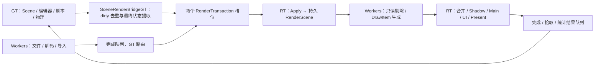

# Hazel：参考本地 UE 5.8 的增量渲染与线程设计

本文是实施方案，尚未实现所述类或修改引擎源码。UE 事实来自本机 `F:/UE/UE_5.8/Engine/Source`；Hazel 方案是按当前 C++17、EnTT、GLFW、OpenGL、ImGui 代码做的简化设计。

核心选择：**主线程保留 Scene/ECS，渲染侧维护一份持久 RenderScene；双缓冲的是跨线程增量事务，不是两份 RenderScene。** 先在同一线程验证协议，再把消费端移动到独立线程。

## 1. 本地 UE 5.8 中实际采用的机制

| 链路 | 本地源码与事实 | Hazel 对应设计 |
|---|---|---|
| 标记变化 | [ActorComponent.cpp:2713](F:/UE/UE_5.8/Engine/Source/Runtime/Engine/Private/Components/ActorComponent.cpp:2713)：设置 `bRenderTransformDirty`，登记帧末更新 | `SceneRenderBridgeGT::MarkDirty`，合并 flags、去重实体 |
| 帧末合并 | [LevelTick.cpp:995](F:/UE/UE_5.8/Engine/Source/Runtime/Engine/Private/LevelTick.cpp:995)：避免组件重复进入待更新列表 | 一帧结束时只提取最终状态 |
| 分类处理 | [ActorComponent.cpp:2667](F:/UE/UE_5.8/Engine/Source/Runtime/Engine/Private/Components/ActorComponent.cpp:2667)：重建状态优先，否则发送 Transform/Dynamic/Instances 更新 | Structural、Transform、Appearance、ResourceBinding 等分组 |
| 拷贝必要值 | [RendererScene.cpp:1634](F:/UE/UE_5.8/Engine/Source/Runtime/Renderer/Private/RendererScene.cpp:1634)：矩阵、bounds 等写入 `FPrimitiveUpdateParams` | 自持数据的 `RenderTransaction` |
| 批量投递 | [RendererScene.cpp:1683](F:/UE/UE_5.8/Engine/Source/Runtime/Renderer/Private/RendererScene.cpp:1683)、[1734](F:/UE/UE_5.8/Engine/Source/Runtime/Renderer/Private/RendererScene.cpp:1734)：先连续收集，再一次投递；非批量路径按值捕获参数 | 一帧一个事务，不为每个矩阵加锁或分配任务 |
| RT 再聚合 | [RendererScene.cpp:1572](F:/UE/UE_5.8/Engine/Source/Runtime/Renderer/Private/RendererScene.cpp:1572) 将更新加入 `PrimitiveUpdates`；[SceneUpdateCommandQueue.h:19](F:/UE/UE_5.8/Engine/Source/Runtime/Renderer/Private/SceneUpdateCommandQueue.h:19) 说明同对象同类型最后值生效 | 第一版在 GT 合并，RT 按事务安全应用；需要时再加 RT 聚合 |
| 安全阶段应用 | [RendererScene.cpp:5568](F:/UE/UE_5.8/Engine/Source/Runtime/Renderer/Private/RendererScene.cpp:5568) 将更新集移交给 RDG 生命周期；[6269](F:/UE/UE_5.8/Engine/Source/Runtime/Renderer/Private/RendererScene.cpp:6269) 更新 proxy 和场景矩阵 | RT 在启动只读渲染任务之前 Apply，再冻结本帧状态 |
| 生命周期 | [RendererScene.cpp:1504](F:/UE/UE_5.8/Engine/Source/Runtime/Renderer/Private/RendererScene.cpp:1504) 按序创建；[2043](F:/UE/UE_5.8/Engine/Source/Runtime/Renderer/Private/RendererScene.cpp:2043) 脱离游戏组件后排队删除 | Create/Update/Destroy 与场景 Reset 都纳入协议 |
| 提取期间不能乱写 | [LevelTick.cpp:970](F:/UE/UE_5.8/Engine/Source/Runtime/Engine/Private/LevelTick.cpp:970) 检测并行提取期间的非法修改 | GT 捕获期间禁止 ECS 写；workers 不读取正在编辑的组件 |
| CPU 完成深度 | [RenderCommandFence.h:17](F:/UE/UE_5.8/Engine/Source/Runtime/RenderCore/Public/RenderCommandFence.h:17) 区分 RT、RHIThread、Swapchain | 单独提供 CPU 序号与 GPU fence，避免混淆 |

这里借鉴所有权、合并、生命周期和同步边界。Hazel 第一版使用一个 GL 执行者、一条有序提交链，无需复制 UE 的 RDG、多 CommandPipe 或额外 RHI Thread。

## 2. 两侧数据由谁持有

| 数据 | 所有者 | 写入者 | 读取者 |
|---|---|---|---|
| Scene、EnTT Registry、脚本、物理配置 | GT（主线程） | GT | GT |
| 本帧 dirty 集合、上次发布快照、实体到渲染 ID 的映射 | `SceneRenderBridgeGT` | GT | GT |
| Writing 中的事务 | GT | GT | GT |
| Ready/Reading 中的事务 | 队列 / RT | 发布后不可修改 | RT |
| 持久 RenderScene、RenderProxy、可见性缓存 | RT（初期可以仍为主线程） | RT 的 Apply 阶段 | RT；只读阶段的 workers |
| GPU Mesh/Texture/Shader/FBO、批处理缓冲、Renderer `s_Data` | GL owner | GL owner | GL owner |
| 已完成的解码/导入数据 | 生产 worker，随后移交队列 | 生产者完成后不再修改 | GT 路由、RT 上传 |
| UI 构建与交互状态 | GT | GT | GT |
| UI 绘制快照 | GT 构建，发布后归 RT | 发布后不可修改 | RT |
| 拾取结果、统计结果、资源完成通知 | RT 产生，GT 消费 | 发布后不可修改 | GT |

不跨线程传 `Scene*`、`Entity`、组件引用、Registry view、临时数组指针。共享资源票据可以跨线程，但票据内容必须不可变；GPU 对象不允许通过票据在 GT 被直接修改。



## 3. ID 与持久代理

### 3.1 三类身份分开

```cpp
struct RenderObjectID {
    uint64_t SceneEpoch;
    uint32_t Slot;
    uint32_t Generation;
};

struct RenderResourceID {
    uint32_t Slot;
    uint32_t Generation;
};
```

- `Entity UUID`：场景文件中的实体身份；EditorScene 复制到 Play Scene 时可能保持相同 UUID。
- `SceneEpoch`：每次激活 New/Open/Play/Stop 对应的新运行表示时递增。不是实体 UUID。
- `RenderObjectID`：某个渲染表示在当前激活场景中的身份，slot 复用时增加 generation。
- `AssetID`：磁盘资产的持久身份；另有 ContentRevision 区分资源内容版本。
- `RenderResourceID`：一次后端资源实例身份，不写入场景文件。
- `OpenGL GLuint`：仅在 GL 后端使用，不作为跨层持久身份。

GT 维护 `entt::entity → RenderBindingGT`，包含 Entity UUID 和 RenderObjectID；RT 只按 RenderObjectID 查代理。任何 Update/Destroy 都校验 epoch、slot、generation。slot 的 dense 存储位置和稳定 ID 分开，压缩数组不能改变对象身份。

### 3.2 一个实体可以有多个渲染部分

当前 Entity 能同时持有 Model、Sprite、Circle、Light。首版为一个实体建立一个 `RenderEntityProxy`，内部包含多个 optional 部分，避免误认为一个实体只能对应一个 Draw。

```cpp
struct RenderEntityDesc {
    glm::mat4 World;
    Bounds GeometryWorldBounds;
    bool Visible;
    bool CastShadow;
    std::optional<ModelRenderDesc> Model;
    std::optional<SpriteRenderDesc> Sprite;
    std::optional<CircleRenderDesc> Circle;
    std::optional<LightRenderDesc> Light;
};

struct RenderEntityProxy {
    RenderObjectID ID;
    RenderEntityDesc State;
    // RT 私有：资源强票据、GPU dirty、稳定实例槽、缓存绘制描述等
};
```

描述中的资源字段使用 RenderResourceID；对应事务和代理持有资源票据，确保句柄仍有效。模型、贴图、Shader 为共享资源；颜色、平铺、可见性、实例材质参数属于代理副本。

Camera 单独放入每帧 ViewPacket；SkyBox 放入场景 EnvironmentState。相机实体没有其他渲染部分时无需创建 RenderEntityProxy。

## 4. GT 如何发现变化：先保证不漏，再减少扫描

当前 TRS 是 public，属性面板、ImGuizmo、脚本、物理回写、反序列化都直接写字段。EnTT `on_update` 只会在显式 `patch/replace` 等路径发布，不会捕获普通引用字段赋值。

证据：[Components.h:39](D:/HazelEngine/myEngine/Hazel/Hazel/src/Hazel/Scene/Components.h:39)、[Entity.h:36](D:/HazelEngine/myEngine/Hazel/Hazel/src/Hazel/Scene/Entity.h:36)、[entt.hpp:7459](D:/HazelEngine/myEngine/Hazel/Hazel/vendor/entt/include/entt.hpp:7459)。

### 4.1 第一个可交付版本：差异扫描

`CaptureEndOfFrame()` 在 GT 的唯一捕获点逐字段比较当前状态与 `LastPublished`。

比较 TRS、组件存在性、颜色、贴图/模型资源 ID 与内容版本、Circle 参数、Light 参数、可见性。不要对整个含 padding、指针、optional 的 Component 使用 memcmp。

- TRS 未变：复用缓存 WorldMatrix，不重复 quaternion/TRS 计算。
- TRS 已变：更新 WorldMatrix、WorldBounds 和 TransformVersion。
- 新出现可渲染实体：Create，携带完整最终描述。
- 已存在实体发生变化：Update。
- 原代理对应实体不再存在，或移除最后一个渲染部分：Destroy。
- Model 仍为同一个 Ref，但资产内容改变：依赖 ContentRevision / 新资源票据识别，不能只比较地址。

这个版本仍然 O(N) 扫描，只把跨线程传输和矩阵计算减少到变化项。它是兼容现有所有写入口的安全迁移手段。

### 4.2 第二个版本：受控修改 + dirty 候选集合

新增 `Entity::PatchComponent<T>(fn)` / `Scene::SetTransform(...)` / `Scene::SetRenderAsset(...)`。内部调用本地 EnTT 支持的 `registry.patch<T>`，或明确标记 dirty。

```cpp
entity.PatchComponent<TransformComponent>([](auto& t) {
    t.Translation.x += 1.0f;
});
```

迁移入口：Hierarchy 属性面板、ImGuizmo、脚本、Box2D 回写、加载/复制、添加/删除组件。各系统的批量修改在完成后统一登记，不需要每个 float 写入都发消息。

dirty flags 建议：

| 标记 | 触发条件 | 衍生影响 |
|---|---|---|
| Structural | 新建、删除、添加或移除渲染部分 | Create/Destroy 或 presence 更新 |
| Transform | TRS 或祖先世界变换变化 | WorldMatrix、bounds、GPU 实例数据 |
| Appearance | Color、Tiling、Circle 参数、实例材质参数 | GPU 参数；必要时绘制分组 |
| ResourceBinding | Model/Texture/Material 票据或版本变化 | 资源绑定、局部 bounds、绘制缓存 |
| Visibility | Visible/CastShadow/图层变化 | 各 Pass 的可见列表 |
| Light | 类型、颜色、强度、范围等 | 光照数据、阴影设置 |
| Environment | 天空盒/环境配置 | 场景全局数据 |

`MarkDirty` 把 flags 按位 OR；同一实体只入候选集合一次。signals 的 construct/destroy 回调只登记候选，不立即生成命令；本地 EnTT 的 destroy 信号发生在实际移除组件之前。

Debug 继续做差异扫描检查“有变化但未标 dirty”的实体。只有完成写入口约束后，Release 才可以关闭兜底全扫描。若继续允许任意持久可变引用，必须保留扫描，不能承诺零遗漏的 O(dirty) 同步。

## 5. 增量事务：只传最终状态

```cpp
enum class ChangeKind { Create, Update, Destroy };

struct ObjectChange {
    RenderObjectID ID;
    ChangeKind Kind;
    RenderDirtyFlags Flags;
    std::optional<RenderEntityDesc> FinalDesc; // Destroy 时无值
};

struct RenderTransaction {
    uint64_t Sequence;       // 全局单调递增，跨 SceneEpoch 不重置
    uint64_t FrameID;
    uint64_t SceneEpoch;
    bool ResetScene;
    std::vector<ResourceUploadRequest> Uploads;
    std::vector<ObjectChange> Changes;
    std::optional<EnvironmentDesc> Environment;
    ViewPacket View;
    UiDrawSnapshot UI;
    std::vector<PickRequest> Picks;
    std::vector<Ref<const RenderResourceTicket>> ResourceKeepAlive;
};
```

上面是接口形状，不是直接可编译的完整头文件。首版 Create/Update 都带变化实体的完整渲染描述，Flags 指明需重建哪些缓存。这样避免不同字段缺省值和“删除 optional 部分”的歧义；仍然不会复制未变化的所有实体。测出 payload 成本后再拆为 TransformUpdates、AppearanceUpdates 等紧凑数组。

新增/移除某个渲染部分时，完整描述中的 optional 明确表示最终存在性；“没有 Update 命令”表示状态保留，不表示删除组件。

### 5.1 合并规则

以“上次成功发布状态”和“本帧最终状态”比较：

| 同一批中的操作 | 发布结果 |
|---|---|
| 尚未发布的 Create → 多次修改 | 一条 Create，取最终值 |
| 尚未发布的 Create → Destroy | 不发送对象命令 |
| Live → 多次修改 | 一条 Update，flags OR、值取最终状态 |
| Live → 修改 → Destroy | 只有 Destroy |
| Live → 删除一个 optional 部分 | Update，新的完整描述明确该部分为空 |
| Live → 删除最后一个渲染部分 | Destroy，ECS Entity 可继续存在 |
| Destroy 旧 ID → slot 被新对象复用 | Destroy(old generation) + Create(new generation) |
| Reset → 新场景对象 | Reset + 新 epoch 的全量 Create |

若 Create 已经进入上一批队列，即使 RT 尚未消费，也必须随后发 Destroy；不能再把它当“未发布创建”取消。

所有 Update 使用绝对状态，如最终 WorldMatrix，而非 `translation += delta`，便于去重、验证与恢复。

### 5.2 提交成功才推进 baseline

1. 冻结 GT 写入，建立本批最终描述。
2. 使用本轮循环开始时已取得的 Writing 槽；不要再次获取另一个槽。背压发生在开始本轮更新之前，不丢增量包。
3. 填充事务并去重资源票据。
4. 成功发布 Ready 后，才更新 LastPublished、清 dirty/tombstone。
5. 若取消、异常或发布失败，保留未发布的变化。

不可变事务交出后，GT 可以开始修改自己的下一帧数据。GT 不再修改该事务。

## 6. 缓冲方案：两份消息，一份 RenderScene

### 6.1 CPU 事务槽

```text
Free → Writing(GT) → Ready → Reading(RT) → Free
```

使用两个预分配槽位，内部 vector clear 后保留容量。`mutex + condition_variable` 管理状态和 FIFO ready 索引；锁内只做发布、取出、归还，Apply/GL 调用/等待 GPU 都不持队列锁。

- GT 在开始下一轮游戏更新前获取 Writing 槽，避免两个槽都忙时逻辑无限领先。
- RT 只取最早 Ready 的事务，校验 Sequence 连续。
- 最多两批已提交且未 CPU 完成：一批可能正在执行，另一批等待；无第三份隐式帧缓冲。
- 发布时 notify；RT 归还时 notify。
- Shutdown/RenderFault 都必须唤醒生产者和消费者，避免等待死锁。
- 普通帧不等待 GPU 全部完成。
- 窗口最小化仍需处理状态/资源/销毁命令和完成通知，可以跳过绘制与 Present。

### 6.2 为什么不会出现双缓冲旧矩阵回跳

A/B 槽只是消息容器。Update 永久应用到 RT 唯一的 RenderScene；下一批没有更新对象 17 时，它继续保留新矩阵。

不维护 A/B 两份彼此可能漏更新的代理状态。因此无需每帧把所有 static 矩阵同步到另一个槽。

### 6.3 可靠性

不丢中间增量事务；不能只保留“最新一帧”。若为了追赶而跳过某批显示，仍必须按序应用其 Create/Update/Destroy/Reset 和资源操作。首版不做跨帧自动合并。

只支持一条 GT→RT 事务生产链。worker 先把结果交给 GT，GT 合并；避免最初就引入多个生产者对生命周期命令排序的问题。

## 7. RT 的逐帧执行和多线程读取

```text
AcquireOldestTransaction
  → 检查 Sequence 连续；非 Reset 必须匹配当前 Epoch，Reset 允许切换到更大的新 Epoch
  → 若 Reset：清旧 RenderScene、标记旧场景结果过期、设置新 Epoch
  → 处理资源创建/上传（同批使用的资源先创建）
  → Destroy 旧代理
  → Create 新代理
  → Apply Update 完整描述及 dirty flags
  → 应用 Environment / View / Resize
  → 更新 bounds、资源依赖、GPU dirty、绘制分组
  → 冻结 RenderScene 的结构和可变渲染字段
  → workers 分块剔除 / 构建各自 DrawItem 列表
  → Join，汇总列表（不透明、透明、2D 顺序分别处理）
  → 上传实例数据，Shadow → Main → 拾取请求 → UI → Present
  → 回收本帧只读任务与 CPU 数据引用
  → Sweep 过期 GPU 资源（GL owner 执行）
  → 发布 CompletedCPUSequence / 统计 / 结果
  → 归还事务槽
```

RT 在只读任务尚未结束时不能 Apply 下一批，也不能对 workers 正在读取的 vector 扩容或删除元素。主线程此时可以更新自己的 Scene，新的结果只进入下一批事务。

Reset 不能提前释放 GPU 尚未完成的旧 PBO、上传区域或拾取 token map；只取消它们的业务结果，待对应使用结束后回收。发布序号仍连续，不能因为 epoch 切换而重置队列序号。

workers 不调用现有 Renderer2D/3D Draw 方法，不修改 static s_Data，不调用 GL，也不写共享 Stats。每任务输出私有数组与计数，RT 汇总。工作量小时串行处理。

阴影可见性与主相机可见性分别计算；不能用“主相机看不见”直接剔除会投到画面内的阴影投射物。透明物体和 2D 图层保留所需顺序。

## 8. 一帧的 GT 时序与通知入口

目标时序：

```text
取得 Free 槽
→ PollEvents
→ 处理 RT 结果、导入完成消息
→ 游戏脚本 / 固定步长物理 / 编辑器相机更新
→ ImGui CPU 构建、Inspector 和 Gizmo 修改
→ 提交本轮 UI 修改
→ GT 调用 ImGui::Render() 完成 CPU draw data；此处不调用 OpenGL backend
→ 更新 GT 世界矩阵和受影响子树
→ CaptureEndOfFrame / 生成增量事务
→ Clone UI 绘制数据，封闭本帧资源引用
→ Publish / notify
→ 下一轮
```

当前 Application 的 Update 在 ImGui 前。迁移阶段可以保留此顺序，并明确 UI 修改在下一次捕获生效；线程正式启用前，再调整为 UI 后统一捕获，不能在两种时序之间不加说明地混用。

### 通知的四种来源

| 来源 | 如何通知 | 何时应用 |
|---|---|---|
| Inspector/Gizmo/脚本/物理 | GT Patch 或 MarkDirty，加入去重集合 | 同轮 CaptureEndOfFrame |
| worker 导入完成 | 线程安全完成队列通知 GT | GT 下一轮处理，路由 UploadRequest |
| GPU 上传完成/失败 | RT→GT 完成队列，携带 ResourceID 与请求版本 | GT 更新资产状态/UI；RT 自己更新依赖代理 |
| 拾取、统计、target 完成 | RT→GT 不可变结果 | GT 验证 epoch/version 后使用 |

帧末生成一次批量消息，不为每次拖动一个 float 唤醒一次 RT。Dirty 只表达最终状态变化，不替代需要逐条处理的输入事件或游戏事件。

## 9. 模型、Sprite、Circle、灯光、天空盒、相机

| 功能 | GT 数据 | RT 持久数据 / 更新方式 |
|---|---|---|
| Model | 资源票据、实例材质参数 | ModelRenderDesc；绑定变化使 local bounds、draw cache 失效 |
| Sprite | Texture、Color、Tiling | SpriteRenderDesc；使用代理 World，填充 RT 的 2D batch |
| Circle | Color、Thickness、Fade | CircleRenderDesc；填充 RT 的 Circle batch |
| Light | 类型、颜色、强度、范围，World 变换 | Light 描述独立收集；移动使光位置/方向及相关阴影变化 |
| SkyBox | Cube 资产票据，可为空 | EnvironmentState，Reset 时恢复默认空环境 |
| Camera | EditorCamera 或选定场景 Camera | 每帧完整复制 View/Projection/Position，二者用同一接口 |
| Viewport | 逻辑视口 ID、请求尺寸、ViewRevision | RT target/FBO、实际像素尺寸、TargetGeneration |
| Visible/CastShadow | 显式实例属性 | 分别影响主 Pass 与阴影列表 |

当前 Renderer3D 的多灯遍历实际覆盖一个共享灯数据。协议可以支持多个 Light 描述，但首个渲染里程碑仍按现有单活动点光源选择策略验收；多灯 Shader、光照列表、多个阴影贴图属于另一个明确里程碑，不能只加 LightProxy 就宣称支持多灯。

材质/模型/贴图共享数据发布后保持不可变；修改资产内容生成新 ContentRevision / 新资源票据。实例 Color 等通过代理更新，避免一个实体编辑意外改变所有共享资产的实例。

## 10. 异步资源与 GPU 对象寿命

### 10.1 CPU / GPU 分层

```text
AssetManagerGT：AssetID → 元数据 / 导入状态 / 版本 / 不可变资源票据
worker：读取文件、图片解码、独立 Assimp Importer，生成自持 CPU 数据
事务：UploadRequest + CPU 数据 + 资源票据
GpuAssetRegistryRT：RenderResourceID → GPU 对象与状态
```

当前 Model(path) 会构造 Mesh 并创建 VAO/VBO；必须先拆 `ImportedModelData` 和 GPU 构建。纹理解码与 glCreateTexture 同样拆开。CPU 数据用移动数组/不可变 blob，不能持有 Assimp importer 销毁后无效的 aiScene 指针。

资源状态至少 `LoadingCPU → PendingGPU → Ready / Failed`。同一资产请求合并，上传按预算执行；大资源需后续分块，单纯异步解码不保证上传不卡顿。

### 10.2 资源句柄本身不拥有对象：推荐票据方案

`RenderResourceTicket` 是跨线程共享的不可变小对象，含 RenderResourceID、AssetID、ContentRevision、类型。GT 组件、队列中的事务、RT 代理和 UI 快照在需要资源期间持有 `Ref<const Ticket>`。

RT 注册表项包含：

```cpp
struct GpuAssetEntry {
    std::weak_ptr<const RenderResourceTicket> Users;
    // RT 独占的 GpuModel/GpuTexture/GpuProgram；不能强持有 Ticket 形成常驻环
    GpuAssetObject Object;
    GpuAssetState State;
    // 父 GPU 资源使用到的子资源；不能仅保存不拥有寿命的 ResourceID
    std::vector<Ref<const RenderResourceTicket>> Dependencies;
};
```

RT 在安全回收点检查 weak ticket 是否过期：所有使用者都释放后，才由 RT 销毁 GPU 对象。最后一份票据在 GT/worker 销毁时只释放 CPU 包装，不执行 GL。

- 票据每个新后端资源实例有新 generation；不会把已释放的 slot 误认成新资源。
- 同一 RenderResourceID 对应唯一票据对象和 shared_ptr 控制块，统一由资源服务创建；使用者复制已有票据，禁止为相同 ID 各自 new 一份票据，否则 weak 过期不再代表全部使用者结束。
- 普通 AssetManager 缓存使用 weak 票据；强常驻只允许显式 Pin。若管理器强持有全部票据，切场景不会自动回收，验收必须先解除相应 Pin/缓存引用。
- 每批事务去重持有资源票据，避免每个 DrawItem 都反复增减多个 shared_ptr。
- RT 代理从事务获得自己的强票据，存活到 Destroy/替换/Reset。
- 模型/材质 GPU 资源通过 Dependencies 强持所用纹理、程序等子资源票据，直到父资源不再使用它们。注册表不得强持自己的 Users 票据；依赖图首版保持无环（如 Model→Material→Texture/Program），禁止反向强引用成环。
- 回收父资源后会释放子票据；子资源可在同次后续扫描或下次 Sweep 回收。资源计数回到基线应在任务、结果队列和这些级联回收处理完成后检查。
- 排队中的 UploadRequest 也持有票据，防止创建前生命周期结束。
- 内置白图/错误图/默认 Shader 有显式常驻票据，在 Renderer shutdown 时释放。
- 资源状态保存在各侧自己的状态表，通过结果消息同步；不要让 GT 直接读取 RT 在写的对象成员。
- Ready 时 RT 更新依赖该资源的代理 bounds/draw cache；未 Ready 可用 placeholder，保留原句柄便于恢复。
- 热重载在新版本创建成功后于帧边界换绑定；旧版本在最后使用者结束后回收。Shader 换版本需要使相关绘制缓存失效。

过渡实现可以让 RT 注册表继续持有现有 Ref<Model>/Ref<Texture2D>，但 GT 的命令描述逐步改为票据；旧 GL 包装对象必须确保在 RT 析构，或使用有效期明确的延迟删除服务。

## 11. 三种缓冲和两种完成，不能混用

| 对象 | 保护谁 | 何时可以复用 |
|---|---|---|
| CPU RenderTransaction 的两个槽 | GT 写 / RT 读 | RT 及引用其内存的 CPU 任务不再读取，上传也不再引用该内存 |
| UBO/VBO/PBO 上传区或持久映射环 | CPU 写 / GPU 读写 | GPU 不再访问对应范围，必要时 GPU fence 确认 |
| FBO 与附件 | GPU Pass 之间的数据 | 按 GL 命令顺序和资源寿命使用；不因 CPU 两槽就自动要求两套 FBO |

第一版可以继续用普通 GL buffer 上传，由驱动处理同步，接受可能的等待；测出瓶颈后再增加 ring/persistent mapping。即使准备三段，也不能假定 GPU 总能在三帧内完成，仍要检查对应 fence。

`CompletedCPUSequence` 只表示后端完成了该事务的 CPU 消费与 API 调用。它不等于 GPU 已完成。若使用 `glFenceSync`，应在相应存储最后一次使用后插入，并在复用该区域前查询；不要每帧 glFinish 把流水线清空。

本地 UE 对应：[RenderCommandFence.h:17](F:/UE/UE_5.8/Engine/Source/Runtime/RenderCore/Public/RenderCommandFence.h:17)、[RHIResources.h:2407](F:/UE/UE_5.8/Engine/Source/Runtime/RHI/Public/RHIResources.h:2407)、[OpenGLQuery.cpp:604](F:/UE/UE_5.8/Engine/Source/Runtime/OpenGLDrv/Private/OpenGLQuery.cpp:604)。

## 12. 编辑器：ImGui、Resize 和异步拾取

### 12.1 ImGui 不能只移动一个函数

GT 负责 GLFW 平台事件、ImGui CPU 布局、ImGuizmo 和 Inspector；RT 负责 OpenGL UI 绘制。发布时深拷贝/拥有 CmdBuffer、IdxBuffer、VtxBuffer 和显示参数；不能让 RT 跨下一次 NewFrame 读取 GT 的原始 ImDrawData。

首版独立线程只验收单平台窗口。当前多视口的窗口创建/销毁/切 context 需要另行设计，保留在后续明确里程碑。

当前 OpenGL3 backend 的 NewFrame 会懒创建 GPU 资源，初始化/字体更新也访问 ImGuiIO。需拆出 RT 的 GPU backend 状态：字体像素在 GT 取得并复制，RT 上传，GT 经完成通知获得 UI 资源绑定；RT draw 不访问被 GT 正在更新的 ImGui 全局上下文。

自定义 UI 回调若依赖 GT 临时内存或 Scene 不允许原样跨线程；首版只支持普通绘制和可安全执行的 reset-state 回调，扩展回调要有明确的自持 payload 与执行线程。

### 12.2 视口纹理使用逻辑绑定

当前 ImGui::Image 直接记录 GLuint。独立线程版改为逻辑 `UiTextureBinding`：资产票据或 ViewportID。克隆 UI draw data 后，由 RT 在绘制前解析到当前有效 GLuint，再调用调整后的 OpenGL UI backend。

这样主线程不需要直接读取/重建 FBO，也不会因同批 Resize 删除旧 attachment 而留下裸 texture ID。所有普通 UI 贴图和字体也走相同寿命约束。

Resize 作为 ViewPacket 中的请求：GT 增加 ViewRevision；RT 在安全阶段创建新 target，记录 TargetGeneration。零尺寸只跳过无效 FBO 创建。旧结果需要验证 view revision，避免把旧尺寸的像素坐标用于新 target。

单一 GL context 下，Scene FBO 先写、UI 后采样、下一帧再覆盖，可以按 GL 顺序组织；不把“CPU 双缓冲”和“FBO 双缓冲”绑定。

### 12.3 拾取协议

```cpp
struct PickRequest {
    uint64_t RequestID;
    uint64_t SceneEpoch;
    uint32_t ViewID;
    uint64_t ViewRevision;
    glm::vec2 NormalizedUV;
};

struct PickResult {
    uint64_t RequestID;
    uint64_t SceneEpoch;
    uint64_t ExecutedFrameID;
    uint64_t ViewRevision;
    uint64_t TargetGeneration;
    std::optional<RenderObjectID> Hit;
};
```

请求采用视口归一化坐标；RT 根据实际 target 尺寸换算。首版在该事务实际渲染的帧上执行，不承诺回读“鼠标点击前屏幕上那一帧”的历史图像。若需要精确历史帧拾取，须保留对应 ID buffer、target 和 token map。

整型拾取附件存 frame-local PickToken，不强行塞入完整 128 位 RenderObjectID。RT 为该帧保留 Token→RenderObjectID 映射；异步 PBO 读回完成前，不可随 CPU 事务槽归还而覆盖映射。

GT 使用结果前检查 epoch、view revision、完整 render ID、绑定的 Entity UUID 和 registry.valid。老场景、旧 generation、已删除实体、旧视口尺寸的结果丢弃。当前 Entity::operator bool 只判非 null，不足以做异步有效性校验。

第一版可先同步读回建立正确性，再减少频率、采用 PBO/fence，允许后续帧返回结果。主线程不阻塞等待鼠标悬停结果。

当前 3D 拾取输出未完整接通，需把 PickToken 接入 Model/Sprite/Circle 的实际 shader 输出；不能仅调整队列就假定已有 3D picking 正确。

## 13. New/Open/Play/Stop、复制和退出

每次激活场景递增 SceneEpoch，发 Reset，再发送当前可渲染实体的初始 Create。旧包按 FIFO 完成后再 Reset；旧拾取结果自然因 epoch 不匹配失效。

Scene::Copy 只复制编辑配置；脚本 Instance、RuntimeBody、RuntimeFixture 清空重建。渲染 ID/GT 发布基线不参与场景复制或序列化。共享不可变资产票据可复用；实例参数与运行状态独立。

退出顺序：

1. 停止新资源请求，取消或等待 worker，处理/取消完成消息，停止新的场景写入。
2. GT 排队 Reset/Destroy，清编辑器预览、场景和 UI 资源票据；保持 RT/队列仍可工作。
3. RT 排空已发布事务和上传请求，停止新绘制与新读回，解除 proxy/UI 的普通引用；暂时保留未决 PBO、target、token map 和 GPU 尚在使用的上传区域。
4. 选择完成读回则先等待并读回，再释放其 PBO/target；选择取消则取消业务结果，不再尝试读回，存储仍保留到 GPU 使用结束。退出阶段可一次等待 GPU，随后释放未决数据、常驻资源、Renderer 静态 Ref、资源注册表和同步对象。
5. RT 解绑 context 并退出，GT join。
6. 主线程销毁 GLFW 窗口并终止窗口系统。

不要先停 RT，再让静态 Ref 析构尝试执行 GL；也不要关闭队列后让等待者永久睡眠。

## 14. 性能与数据布局

- WorldMatrix 缓存，Transform dirty 才计算；父节点变化传播到后代。
- 首版对象描述数组预分配；不为每个对象创建线程或堆分配命令。
- 单帧同对象变化合并；以绝对状态发布。
- 静态代理、资源和稳定绘制描述跨帧保留；可见列表仍可能按帧生成。
- O(N) 差异扫描与 O(dirty) 更新传输分别统计；不能把前者省略不计。
- 后续紧凑 typed payload / SoA 按实测引入；仿射 48B 格式要显式打包，不能截取 glm::mat4 的前 48B。
- 实例化减少 DrawCall；GPU dirty upload 减少传输；两者独立验收。
- GPU instance slot 若稳定，可按 dirty range 上传；若按可见性每帧重排，就要维护索引或接受当帧可见数据全量上传。
- Debug 单线程执行同一事务协议，便于与双线程模式对比。

监测：Total/Dirty/Create/Update/Destroy、TRS 重算数、事务字节数、队列等待、Capture/Apply/Cull/Submit 耗时、GPU Shadow/Main/UI 耗时、上传字节、资源驻留、在途拾取数、CPU/GPU fence 等待。

现有 Instrumentor 并发写共享流且每事件 flush，需要先换线程安全缓冲记录；统计结果通过完成队列回 GT，不跨线程读取 s_Data.Stats。

## 15. 代码模块和实施顺序

建议新增类的职责（名称可按工程风格调整）：

| 类 | 职责 |
|---|---|
| SceneRenderBridgeGT | dirty、差异扫描、GT binding、矩阵缓存、事务构建 |
| RenderTransaction / RenderTypes | 自持数据协议、ID、描述、View/UI/Pick 数据 |
| RenderScene | RT 持久代理表、Apply、资源依赖、只读视图 |
| SceneRenderer | 使用 RenderScene 绘制 Shadow/Main/Sky/UI，统一编辑与运行相机 |
| RenderService | 单线程/双线程切换、两个槽、CPU 序号、启动/关闭 |
| GpuAssetRegistryRT | GPU 对象、票据弱索引、上传、过期资源回收 |
| AssetImportService | worker 文件读取/解码/模型导入、完成队列 |
| EditorUiRenderer | UI 深拷贝、逻辑纹理解析、GL UI 状态 |

### M0：同线程的增量协议

新增 Bridge/Transaction/RenderScene；保留 GL owner 为主线程。先用差异扫描、不漏现有 public 写入；统一模型/Sprite/Circle/Light/Environment 描述和 Camera。修场景初始化与 runtime 配置复制。

验收：静态帧第二帧 Create=0/Update=0；同一物体改十次只有一次 Update；New/Open/Play/Stop 画面一致；编辑器任意写入口均被捕获。此时不宣称 CPU 多线程提速。

### M1：通知机制与写入口迁移

接 Patch/dirty signals、Transform 缓存、Debug shadow scan，保持直接写兼容策略明确；检查新增/删除 optional 部分和资源版本。只有迁移完成后才关闭 Release 全扫描。

验收：脚本、物理、Inspector、Gizmo、反序列化均不漏；修改后又改回已发布值可以不发 Update；层级变化的 bounds 正确。

### M2：CPU/GPU 资源分层与异步导入

拆解码/上传、实现资源票据与 RT GPU 注册表，先同线程消费；补默认资源、加载失败、依赖贴图、重试和版本替换。

验收：同资源不重复导入/创建；切场景后运行时独有资源回到基线；最后票据在 worker 释放不执行 GL；退出时无 context 失效后的删除。

### M3：独立 RenderThread 与单窗口编辑器

接两个事务槽、FIFO 背压、context 迁移、PollEvents/Present 分离；所有 GL 与 Resize 在 RT；UI 快照、逻辑纹理、字体和拾取协议接通。保留同步执行模式。

验收：slow RT/队列满、minimize、resize、资源加载失败、窗口关闭、Play/Stop 快速切换均能结束且不丢状态。每个 GL 入口加 owner 线程断言。

### M4：只读并行准备与 GPU 优化

RT Apply 完成后才分发剔除/DrawItem jobs，Join 后提交；再依测量做实例化、dirty upload、GPU ring/PBO fence。

验收：与串行可见集/绘制顺序对照；100/1000/10000 个实例的相同场景测 Capture、Apply、Cull、Submit、GPU 与 P95。对象少时允许自动串行。

### M5：扩展能力

在基础协议稳定后分别开发多平台 ImGui 窗口、多灯与多阴影、独立材质资产/编辑、复杂层级、Shader 热重载工具。每项都继续遵循消息所有权、版本和 owner-thread 约束。

## 16. 必须通过的协议验证

1. Create→Update 合并为最终 Create；未发布 Create→Destroy 不产生 proxy。
2. 已发布 Create 即使尚未消费，随后 Destroy 仍可靠到达。
3. Update→Destroy 只执行最终删除；optional 部分移除不会残留旧几何。
4. Destroy(generation N) 后 Create(N+1)，旧 Update/Pick 不得影响新对象。
5. 队列持续满，Sequence 连续，无 Create/Destroy 丢失，LastPublished 不提前推进。
6. 场景 Reset 与旧结果交错，epoch 隔离；EditorScene/PlayScene 同 UUID 不混淆。
7. 双槽交替，静态对象不回跳；未变化帧保持 RT 的最新状态。
8. 多个只读 jobs 未结束时下一事务不能修改其数据；线程断言与压力延迟可复现验证。
9. 资源 Loading/Ready/Failed、删除、重试、热换版本交错，票据与 GPU 注册表无悬空句柄。
10. UI 记录后 Resize，不出现已删除的裸 texture ID；旧尺寸 Pick 不误选。
11. CPU 槽已归还但 PBO/GPU 数据尚在使用，独立保留正确内存与 token map。
12. 窗口最小化与关闭期间仍能排空队列；没有 join/CV 死锁；所有 GL 删除早于 context 销毁。

前 7 项可以先做不依赖 GPU 的 RenderScene/协议测试；画面一致性、UI、拾取与 GL 生命周期再做集成验证。本次仅产出设计，未运行上述测试。
